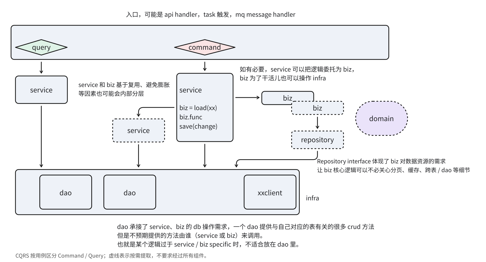

# 边界与依赖

## 分离关注点

- 程序 = Logic + Control。Logic 表达业务判断与变换，Control 决定这些逻辑何时、以什么顺序、分支、
  并发或重试方式执行；业务逻辑与流程控制、协议适配、线程异步、调度胶水必须分离。
- 好的抽象会固化稳定、重复的控制骨架，并显式暴露持续变化的业务逻辑。`map`、`reduce` 没有消灭控制流，而是隐藏了遍历、累积等通用控制；`toUpper`、`sum` 等传入函数负责表达具体逻辑。目标是分离变化边界，不是追求函数式语法。
- what / how 相对于抽象层级存在：高层代码描述要完成哪些步骤，低层代码负责每一步如何完成；同一函数不要在组织主流程和展开协议、算法细节之间反复切换。
- 分层的意义是隔离变化、降低认知负担、支持协作，不是为了把目录凑齐。
- Request、DTO、ORM、外部协议对象不要直接进入核心业务层。

## 入口、业务与机制

从职责分层看，系统通常可以读作 **入口 → 业务概念与流程 → 底层机制**：入口承接触发，业务层表达对象、规则与协作，机制层提供与调用方业务无关的基础设施能力。这个视角说明系统如何被驱动、如何完成工作，与“系统=概念+流程”的建模视角互补。自下而上看，基础设施的资源与能力经业务概念赋予业务语义，再由流程组合成业务操作。

### 入口：承接触发

入口包括
1. 启动入口，负责组装、启动与关闭的 `main`
2. 操作入口，HTTP 请求、queue 消息
3. 定时与循环任务等运行时触发。
入口handler 负责处理协议与触发上下文，选择并调用业务流程；handler 保持薄，薄厚看职责而非行数：流式协议处理可以较长，但业务策略、资源归属与生命周期决策应由业务层承接。若新增入口需要复制这些决策，或普通需求总要在入口层跨域改状态，应检查是否缺少核心概念或统一流程入口，而不只是拆小 handler 文件。

### 业务概念与流程：表达规则并组织协作

核心概念承载身份、归属、策略和生命周期约束，流程组织一个或多个概念协作，决定为何、何时、为谁使用底层能力。入口形式不同，共用的领域规则与约束仍应由同一 owner 维护。
1. 简单业务，一般一层 (比如web服务里的Service) 即可。
2. 复杂业务，可能需要两层组合
  1. high level 模块，一般与操作入口对应（靠近user interface），组合domain层，负责“系统=概念+流程”里的“流程”。
  2. domain level 模块，负责组织业务概念协作（靠近业务/领域模型），负责“系统=核心概念+流程”里的“概念”

在常见的 Controller / Service / DAO 结构中，Controller 对应请求入口，Service 承接业务逻辑，DAO 承接基础设施中的数据访问。业务复杂后，可以从 Service 中提取业务组件：Service 组织用例流程，业务组件封装内聚的业务规则与操作能力，并按职责访问所需的基础设施。Service 与业务组件共同构成业务层，都可以按职责直接使用 DAO、client 等基础设施，也可以为复用或控制复杂度进一步拆分内部组件；简单业务无需强行拆分。

此时，Service 可以形成相对通用的流程：**信息查询 → 调用业务组件 → 信息保存**。先取得相关对象及状态，将对象直接或经必要转换后交给业务组件，再根据执行结果保存状态。Service 负责用例约束、调用顺序和结果协调；业务组件负责具体能力，并通过不同实现承接执行差异。这是常见的流程骨架；业务组件也可以自行查询和持久化，具体归属与顺序由职责、事务、并发和故障恢复要求决定。拆分组件是为了明确职责，不要求各实现采用统一的中间对象或返回变更集。完整流程由组合这些组件的 owner 负责，组件各自完成被委托的职责。

### 底层机制：提供基础设施能力

机制层负责如何完成底层操作，并报告实际结果。它有自己的技术契约与资源生命周期，但不应认识调用方的业务对象，也不预设能力只能供某个业务域使用。提取通用能力时，检查接口是否仍夹带调用方身份、特殊路径或策略分支；这些语义由业务侧适配。

DAO 围绕自己负责的表与数据提供查询、增删改、条件更新等操作，承接 Service 与业务组件的数据访问需求。方法契约描述操作的数据、条件和结果，不预设由 Service、某个业务组件还是其他流程调用。调用方特有的业务策略，例如是否继续观测、哪些变化需要立即入库，应留在相应业务组件；DAO 负责执行数据操作及其一致性约束。

业务组件可以直接持有所需 DAO；仅因提取了业务组件，不必再增加一层转发式 Store / Repository。需要抽象时，围绕实际的替换、复用或隔离需求定义契约。

## 依赖朝稳定方向流动

- 核心业务优先依赖稳定抽象，不依赖外部接口、框架、数据库和消息协议细节。
- 接口是业务抽象和耦合方式的结合点，接口设计比数据结构更重要。
- 判断边界时同时问：事实由谁拥有、生命周期由谁收口、哪一侧更稳定。

## 深模块优于浅模块

- 模块应能力强、接口少、语义清晰。
- 只包装一层调用却增加概念、参数和跳转成本的是浅模块。
- 默认把常见路径收敛在模块内部，特殊行为再通过有限扩展点暴露。

## 资源提供方保持领域纯粹

- Manager、Service、Repo 等资源提供方只管理自己的领域模型，不依赖调用方的 DTO 或外部模型。
- 跨模型转换由同时了解两侧的调用方负责；复杂且多处复用时提取独立 Adapter / Mapper。
- 资源提供方应返回自身领域对象，不提供 `to_xxx_dto()`、`to_external_model()` 等跨层转换。
- 检查顺序：提供方是否依赖调用方模型 → 转换是否应留在调用方 → 是否真的需要独立 Mapper。

完整反例与改法见 [资源提供方保持领域纯粹](../examples/provider-stays-domain-pure.md)。
